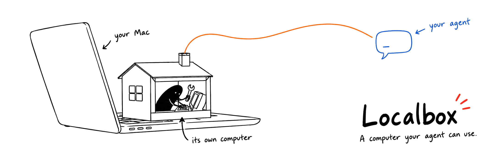
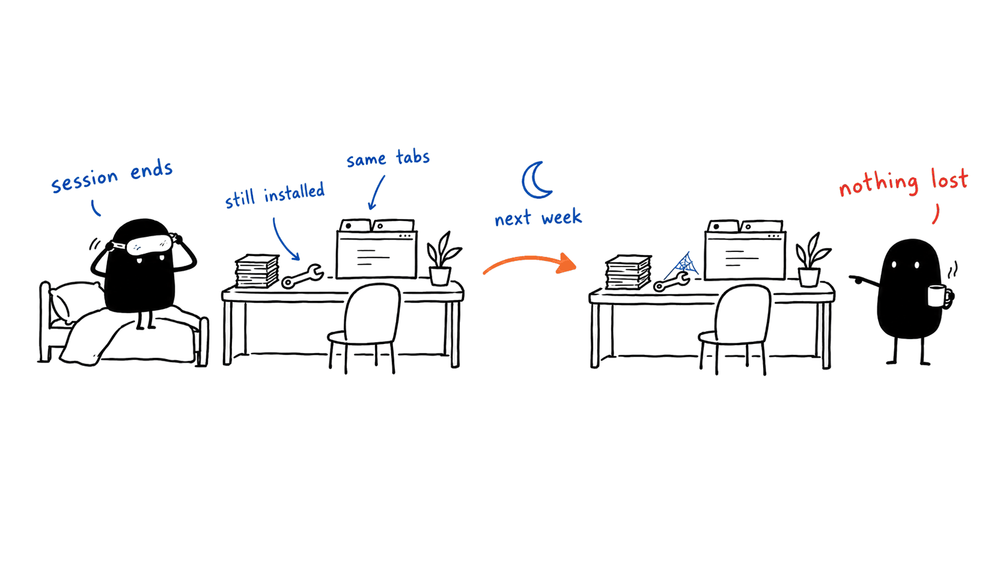
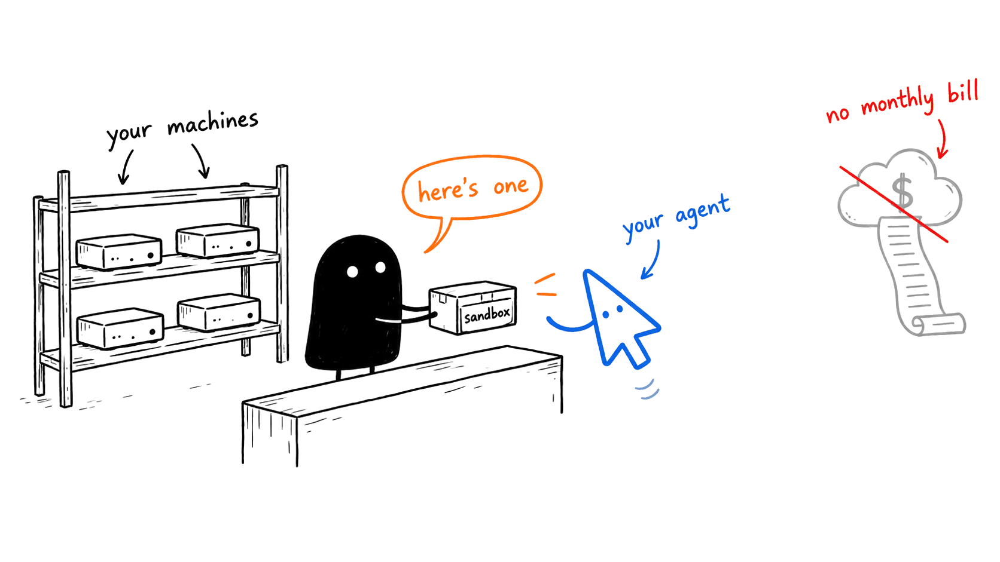
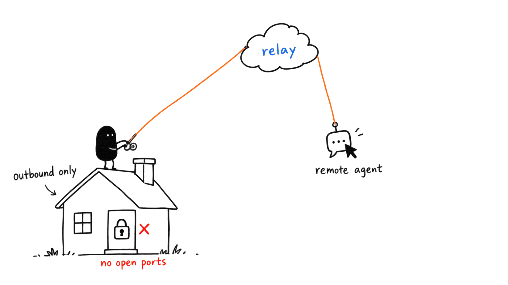
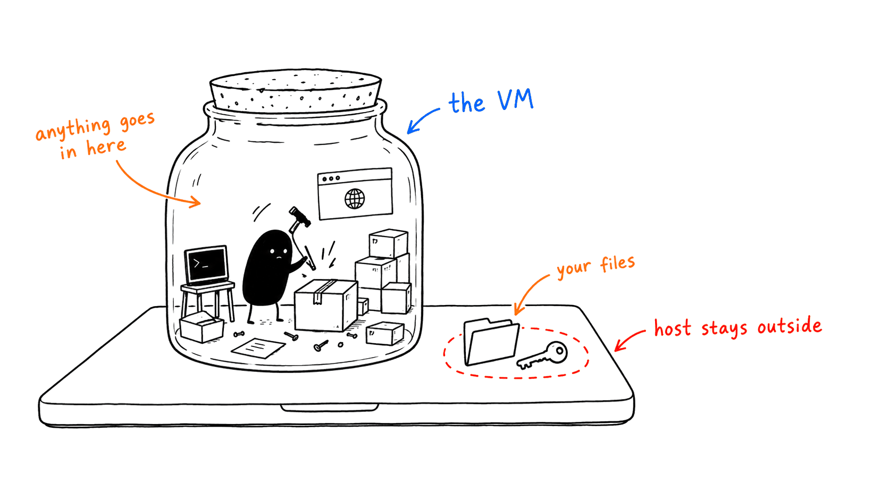
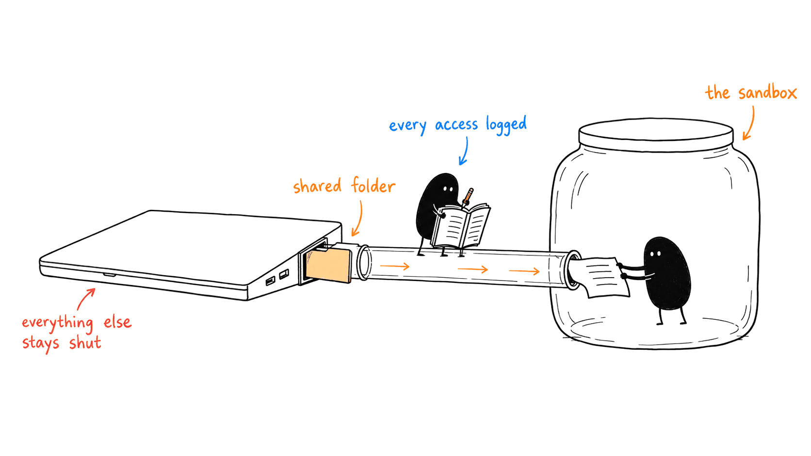
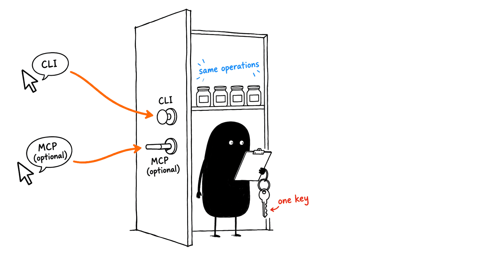

<p align="center">
  
</p>

<p align="center">
  <a href="https://github.com/dzhng/localbox/releases/latest"></a>
  
  
  
</p>

---

**Localbox gives your AI agent durable sandboxes, on computers you already own.**

Your agent is ready to do real work: install toolchains, run test suites, click
through a staging site, leave a build running overnight. It needs somewhere to do
that. Your laptop is too precious to hand over. Docker on a Mac eats gigabytes of
RAM the moment it starts and leaves containers to prune. Cloud sandboxes bill you
every month, cap every session, and put your code on someone else's computer.

Localbox turns your Mac, or a shelf of Mac minis, into sandboxes your agent
creates, uses and deletes on its own. Each sandbox is a whole Linux computer with
a shell, files, a browser and a desktop, and it stays exactly as the agent left it
until someone deletes it. **Claude Code, Codex, or any agent harness** drives it
through one CLI, with an optional MCP endpoint.

**Durable sandboxes for your agent. Free, on your own machines.**

## Durable by default

<p align="center">
  
</p>

Cloud sandboxes and containers are built to be thrown away, so every session
starts by reinstalling the world. A Localbox sandbox keeps its files, installed
packages, browser profile and desktop across sessions, sleep and reconnects. Set
it up once and it's still set up next week.

Durable doesn't mean hogging your Mac. A sandbox nobody has used for 30 minutes
goes to sleep: its memory is saved to disk and the RAM comes back to you. The next
request wakes it in seconds with every process exactly where it was, down to the
dev server it left running. When a sandbox should be disposable, give it an idle
timeout and it deletes itself once nobody's using it. Nothing to prune.

**[Get started →](#get-started)** Your agent installs it for you.

## Things you can ask for

> "Spin up a sandbox, clone this repo and get the tests passing."

> "Run this with permissions off, inside a sandbox, not on my laptop."

> "Give each of these three branches its own sandbox and dev server."

> "Use the Mac mini in the closet for tonight's full build."

> "Share `~/code/app` read-only with the sandbox, then show me every file it read."

> "Pick up where we left off yesterday. The dev server should still be running."

> "That sandbox is too small for the full test suite. Give it 8 GB."

## Your machines are the fleet

<p align="center">
  
</p>

You probably already own spare compute: a Mac mini on the shelf, last year's
laptop. Sign each one in with your email and it joins your fleet, even from
another country. Sandboxes stay on the machine your agent is running on unless it
asks otherwise: name a machine, or let Localbox pick whichever has the most room.
No per-minute billing, no session limit, and your code never leaves hardware you
own.

## Cloud agents, your computers

<p align="center">
  
</p>

Background agents like Codex cloud and Claude Code on the web can do their work in
your sandboxes instead of rented ones. Each Mac connects **out** to a hosted relay,
so there's no port forwarding, VPN or Tailscale. A cloud agent signs in with your
email and a code, gets a token for your account that you can revoke any time, and a
request that may have half-applied is reported as uncertain, never silently
retried.

## Let your agent off the leash

<p align="center">
  
</p>

The fastest agents run with permission prompts off, and that's exactly what nobody
wants on their own laptop. Inside a sandbox, let it. The sandbox is the boundary,
so there's nothing inside worth prompting about: install anything, run untrusted
scripts, break things. The worst case is deleting the sandbox.

## Share a folder, see every access

<p align="center">
  
</p>

A sandbox sees nothing on your Mac by default. When your agent needs a project,
share exactly that folder, read-only unless you say otherwise, and Localbox logs
every file the sandbox reads or writes through it. Your processes, credentials and
screen are never shared. The [security model](SECURITY.md) spells out the
boundary.

## One catalog, two ways in

<p align="center">
  
</p>

The CLI is the product, and its customer is your agent. MCP is an adapter over
the same operation catalog, with identical operations, schemas, errors and
permissions, so a request means the same thing from a shell, Claude Code, Codex or
a script. Every command does what it was asked when the result can be undone, then
says exactly what it did: the size and machine it chose, the sandboxes it slept to
make room, the output it trimmed. Your agent never has to guess.

| | What your agent can use |
| --- | --- |
| **Sandboxes** | Create, list, rename, resize, sleep, wake and delete; sized to the machine, durable by default, optional idle deletion |
| **Machines** | Sign in with an email code; list, rename and remove machines; place sandboxes locally, on a named machine, or automatically |
| **Shell** | Run bounded commands, or start long jobs and wait, poll, cancel or read their output |
| **Files** | List, read, write, create and remove paths inside the sandbox |
| **Browser** | Open, navigate and close tabs; click, type, send keys and take screenshots |
| **Desktop** | Screenshot, move, click, scroll and type on a 1440×900 virtual display |
| **Shared folders** | Share a host folder read-only or read-write, and read its access log |

## What works today

This README describes the product we're launching. Today one Mac runs one durable sandbox: lifecycle, shell, files, browser and
desktop operations, the CLI and optional MCP, the outbound relay, and signed
releases with automatic updates. Creating and deleting sandboxes on demand, sleep
and idle deletion, sizing and resize, multi-machine fleets and placement, email
sign-in, and shared folders with an access log are in progress. Sleep needs
macOS 14. The [positioning](positioning.md) doc tracks each one.

## Get started

Requires **Apple Silicon and macOS 14 or newer**. Free.

Open Claude Code or Codex and say:

> Install Localbox for me by following https://localbox.sh/llms.txt

Then ask for something that needs a sandbox.

Installs work once the first signed [release](https://github.com/dzhng/localbox/releases)
is published. The [agent setup](#agent-setup) below is what your agent follows.

## Agent setup

These steps are written for the agent doing the install, so they are precise and
describe only what the current release does.

1. **Install from a signed release.** Resolve one stable tag from
   [GitHub Releases](https://github.com/dzhng/localbox/releases/latest), download
   the release kit with its `release.json` and `SHA256SUMS`, verify them against
   the pinned [release public key](skills/localbox/release-public.pem), and run
   the bundled installer. The [installation procedure](skills/localbox/references/installation.md)
   holds the exact commands. Do not build from source for a user install, and do
   not install or copy the skill yourself.
2. **Check the install.** The installer places the CLI at `~/.local/bin/localbox`,
   registers the host daemon, the relay connector and the updater with launchd,
   and installs the global [Localbox skill](skills/localbox/SKILL.md) for every
   agent harness on the Mac. It bundles its own Node runtime, so it never calls
   the host's `npx` or `npm`. Then run:

   ```sh
   ~/.local/bin/localbox skill status
   ~/.local/bin/localbox agents setup status
   ~/.local/bin/localbox help
   ```

3. **Read the skill.** Start a fresh session so the Localbox skill is loaded.
   It is the reference for using Localbox; this README is not.

Updates arrive automatically and verify before replacing anything;
`localbox update check` and `localbox update install` do the same on demand.
With agent setup on (the default), every install and every start of the host
daemon makes the skill and the `localbox` command match the installed release.
The [skill lifecycle](skills/localbox/references/skill-lifecycle.md) covers
turning that off, backups and project installs.

## Contributing

Localbox is an npm workspace monorepo: `apps/*` holds product surfaces (CLI,
macOS host daemon, guest agent, relay, MCP, website) and `packages/*` holds the
shared contract, runtime and protocol owners.

```sh
npm install
npm run build
npm test
```

The [positioning](positioning.md) doc holds the product message and use cases.
The [development guide](DEVELOPMENT.md) records the principles behind the public
contracts, plus local control-plane smoke tests, deployment configuration and the
release process. The [security model](SECURITY.md) defines the trust boundaries,
and the [rationale](specs/done/agent-computer/README.md) explains why the system
has this shape. The [website](apps/site/README.md) is the public page at
[localbox.sh](https://localbox.sh), with the same instructions as plain text for
agents. README artwork lives in [.github/readme](.github/readme).
