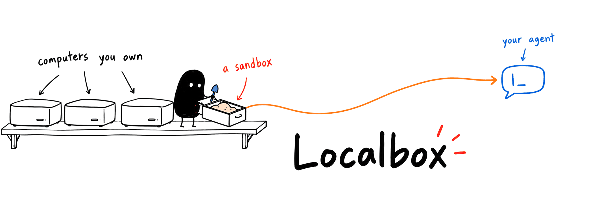
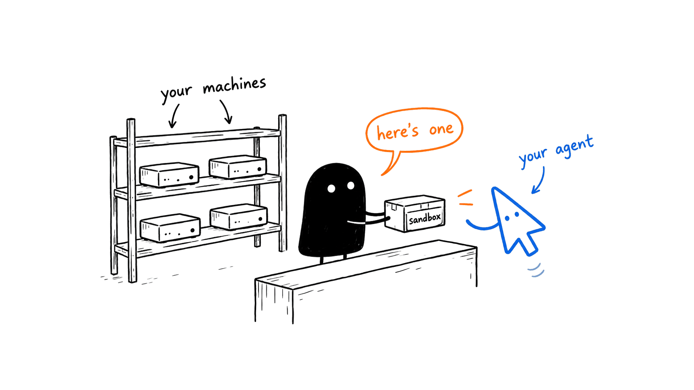
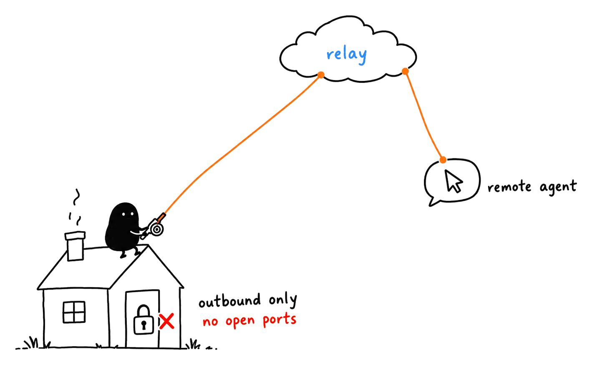
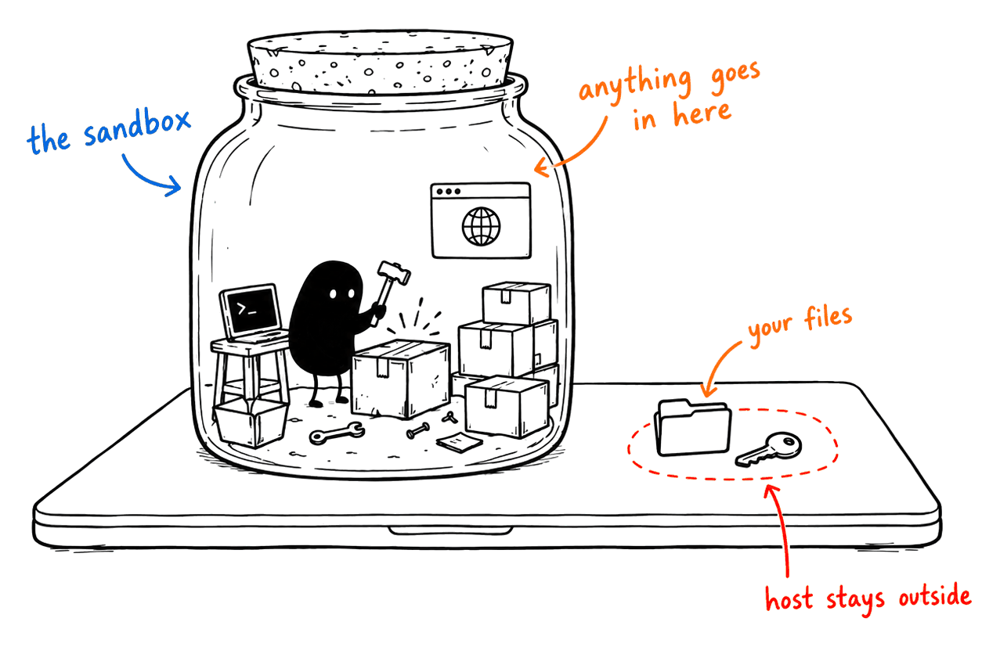
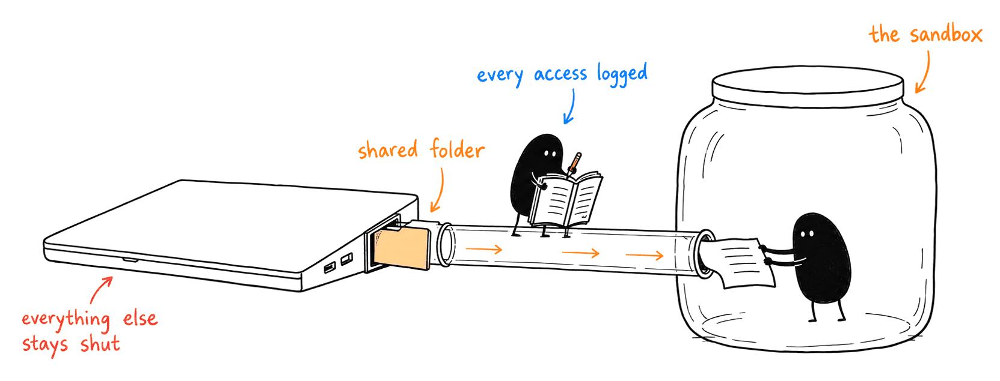
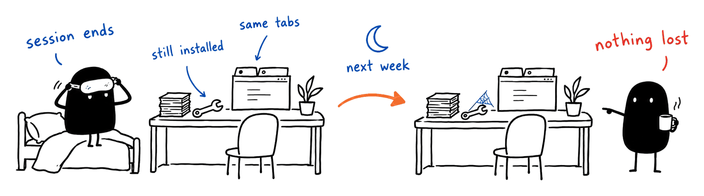
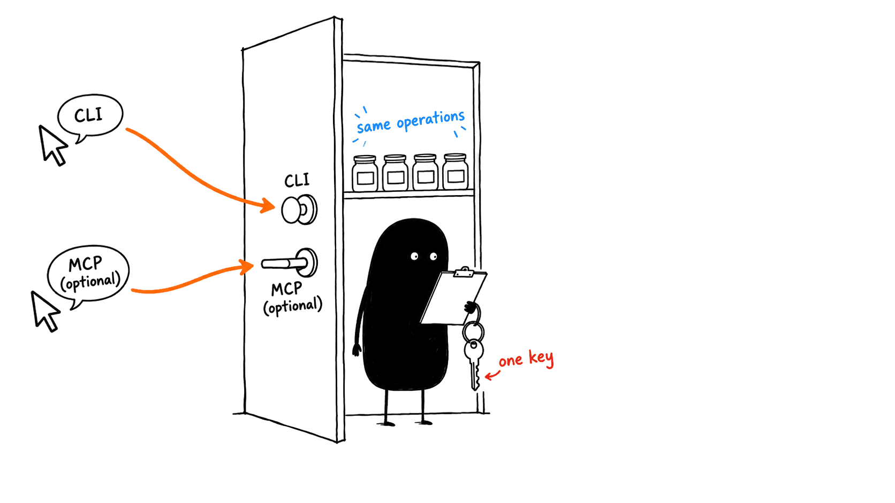

<p align="center">
  
</p>

<p align="center">
  <a href="https://github.com/dzhng/localbox/releases/latest"></a>
  
  
  
  
</p>

---

**Stop renting sandboxes. You already own them.**

Localbox turns every Mac you own into sandboxes for your agents: Linux or macOS,
set up your way, and still there next week. Free.

Your agent needs somewhere to work that isn't your laptop: install toolchains,
run test suites, click through a staging site, leave a build running overnight.
The usual answer is a cloud sandbox, rented by the minute, thrown away when the
session ends and set up from scratch every time. Meanwhile the desktop with the
RAM for the full build and the Mac mini on the shelf sit idle.

Localbox lets every agent you run, on your laptop, in the cloud or on a schedule,
work on every Mac you own. Each one gets a **sandbox** there: a whole computer,
Linux or macOS, with a shell, files, a browser and a desktop, that stays exactly
as the agent left it. Set one up the way you like, save it as an image, and every
new sandbox starts from it. Your agent never gets your whole computer, the way it
would over SSH, and sees none of your files unless you share a folder.
**Claude Code, Codex, or any agent harness** drives it through one CLI, with an
optional MCP endpoint.

**[Get started →](#get-started)** Your agent installs it for you.

## Things you can ask for

> "Use the Mac mini in the closet for tonight's full build."

> "Set up a sandbox with our toolchain and make it my default image."

> "Give each of these three branches its own sandbox, on whichever Macs have room."

> "Open a macOS sandbox, install Xcode with my Apple ID, and run the iOS tests."

> "Make the Mac mini a GitHub Actions runner for this repo, inside a sandbox."

> "Run this with permissions off, inside a sandbox, not on my laptop."

> "Pick up where we left off yesterday. The dev server should still be running."

## Stop renting sandboxes

<p align="center">
  
</p>

A cloud sandbox is someone else's computer by the minute. It forgets everything
when the session ends, so every session starts by reinstalling the world. You
probably own more compute than your agent uses: a desktop with the RAM for the
full build, a Mac mini on the shelf, last year's laptop. Sign each one in with
your email and it joins, even from another country. Sandboxes stay on the machine
your agent is running on unless it asks otherwise: name a machine, or let
Localbox pick whichever has the most room. Start with the Mac you have; every Mac
you add joins. No per-minute billing, no session limit, and your code never
leaves hardware you own.

## Every Mac, from anywhere

<p align="center">
  
</p>

Background agents like Codex cloud, Claude Code on the web and scheduled agents
reach your computers from wherever they run, and do their work in your sandboxes
instead of rented ones. Each Mac connects **out** to a hosted relay, so there's no
port forwarding, VPN, Tailscale or SSH key. A cloud agent signs in with your
email and a 6-digit code emailed to you, gets a token for your account that you can
revoke any time, and a request that may have half-applied is reported as uncertain, never silently
retried.

## Set up your way

Every developer's setup is different, and your agent shouldn't rebuild yours for
each task. Set a sandbox up once (toolchains, dotfiles, a logged-in browser) and
save it as an **image** while it keeps running; it pauses for about a second.
Make that image your default and every new sandbox starts from it, each with its
own identity. Images move straight from one of your Macs to another, over your
local network or a direct connection across the internet, never through anyone's
cloud storage. Ask for a sandbox on a Mac that doesn't have the image yet and
Localbox copies it there first, then tells your agent the size, time and path the
copy took.

## macOS sandboxes

Some work needs a Mac: building and testing iOS and Mac apps in Xcode, or driving
a Mac app through its desktop. A **macOS sandbox** is a whole Mac of its own, with
everything a Linux sandbox has, desktop and browser included. Localbox builds the
macOS base on your own Mac from Apple's restore image, with nothing for you to
click through, and installs Chrome. Xcode needs your Apple ID, so your agent
installs it once in a macOS sandbox and saves that as an image. macOS sandboxes
need macOS 27 or newer on the Mac, and Apple's licence allows two running at a
time on each Mac, for your own development and testing.

## Your own GitHub Actions runners

CI is rented by the minute too, and macOS minutes on GitHub cost the most of
all. Your Macs can take those jobs instead: your agent registers a self-hosted
runner inside a sandbox, so a workflow can install and run anything without
touching your real Mac. Linux sandboxes run arm64 jobs; macOS sandboxes run
Xcode builds and iOS tests. It sets the runner up once, saves it as an image,
and starts each new runner from it. A sandbox running its runner doesn't sleep
and the Mac doesn't idle-sleep under it, and the runner keeps running through
the Mac's sleep and Localbox updating itself. macOS runners are for your own
repositories.

## A sandbox, not your whole computer

<p align="center">
  
</p>

SSH would hand your agent your whole computer, on every machine: your files, your
keys, your logged-in sessions. Localbox hands it a sandbox instead. And the fastest
agents run with permission prompts off, which is exactly what nobody wants on
their own laptop. Inside a sandbox, let it. The sandbox is the boundary,
so there's nothing inside worth prompting about: install anything, run untrusted
scripts, break things. The worst case is deleting the sandbox. Each sandbox is a
full Linux or macOS virtual machine on Apple's own Virtualization framework, the
one built into macOS, with its own kernel, disk and network. Much safer, and much
easier to set up, than SSH and Tailscale.

## Share a folder, see every access

<p align="center">
  
</p>

A sandbox sees nothing on your Mac until you say so. Your agent shares exactly
the folder it needs, read-only unless you say otherwise, and Localbox logs every
file the sandbox reads or writes through it. Your processes, credentials and
screen are never shared. The [security model](SECURITY.md#the-vm-is-the-boundary) spells out the boundary.

## Still there next week

<p align="center">
  
</p>

Close your laptop and the work keeps going. Cloud sandboxes and containers are
built to be thrown away. A Localbox sandbox keeps its files, installed packages,
browser profile and desktop across sessions, sleep and reconnects. Set it up once
and it's still set up next week.

Durable doesn't mean always running. A sandbox nobody has used for 5 minutes
goes to sleep, and the next request wakes it with every process exactly where it
was, down to the dev server it left running (a running job counts as use).
While a sandbox runs, or an image builds or copies, the Mac doesn't idle-sleep
under it; the display still sleeps, and closing the lid still sleeps the Mac.
When a sandbox should be disposable,
give it an idle timeout and it deletes itself once nobody's using it. Nothing to
prune.

## One catalog, two ways in

<p align="center">
  
</p>

The CLI is the product, and its customer is your agent. MCP is an adapter over
the same operation catalog, with identical operations, schemas, errors and
permissions, so a request means the same thing from a shell, Claude Code, Codex or
a script. Every command does what it was asked when the result can be undone, then
says exactly what it did: the size and machine it chose, the sandboxes it slept to
make room, the image it started from and the copy it made to get it there, the
output it trimmed. Your agent never has to guess.

| | What your agent can use |
| --- | --- |
| **Sandboxes** | Linux or macOS. Create, list, rename, resize, sleep, wake and delete; sized to the machine, durable by default, optional idle deletion |
| **Images** | Save any sandbox as an image, make one the default, copy images directly between your Macs, and start sandboxes from any of them |
| **Machines** | Sign in with an email code; list, rename and remove machines; place sandboxes locally, on a named machine, or automatically |
| **Shell** | Run bounded commands, or start long jobs and wait, poll, cancel or read their output |
| **Files** | List, read, write, create and remove paths inside the sandbox |
| **Browser** | Open, navigate and close tabs; click, type, send keys and take screenshots |
| **Desktop** | Screenshot, move, click, scroll and type on a 1440×900 display, Linux or macOS |
| **Shared folders** | Share a host folder read-only or read-write, and read its access log |

## Get started

Requires **Apple Silicon and macOS 14 or newer**; macOS sandboxes need
**macOS 27 or newer**. Free.

Open Claude Code or Codex and say:

> Install Localbox for me by following https://localbox.sh/llms.txt

Your agent installs Localbox, a menu bar app, with no click and no password,
then asks you for the 6-digit code it emails you to sign this Mac in. Then ask
for something that needs a sandbox. Click the menu bar icon to see this Mac's
sandboxes, images and connection at a glance. The [agent setup](#agent-setup)
below is what your agent follows.

## Agent setup

Your agent follows the [installation procedure](skills/localbox/references/installation.md):
one signed release, verified, then the Localbox menu bar app, which sets up the
CLI and the [Localbox skill](skills/localbox/SKILL.md), runs the background
services and opens at login. Quitting it takes the Mac offline; any `localbox`
command opens it again. It updates itself; the
[skill lifecycle](skills/localbox/references/skill-lifecycle.md) covers updates
and keeping the skill current, and the installation procedure ends with how to
remove Localbox.

## Contributing

Localbox is an npm workspace monorepo: `apps/*` holds product surfaces (CLI,
macOS host daemon, guest agent, relay, MCP, website) and `packages/*` holds the
shared contract, runtime and protocol owners.

```sh
npm install
npm run build
npm test
```

The [positioning](positioning.md) doc holds the product message and use cases.
The [development guide](DEVELOPMENT.md) records the principles behind the public
contracts, plus local control-plane smoke tests, deployment configuration and the
release process. The [security model](SECURITY.md) defines the trust boundaries,
and the [rationale](specs/done/agent-computer/README.md) explains why the system
has this shape. The [website](apps/site/README.md) is the public page at
[localbox.sh](https://localbox.sh), with the same instructions as plain text for
agents. README artwork lives in [.github/readme](.github/readme).
